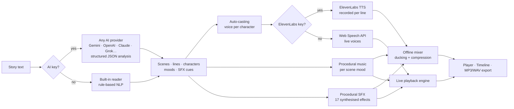
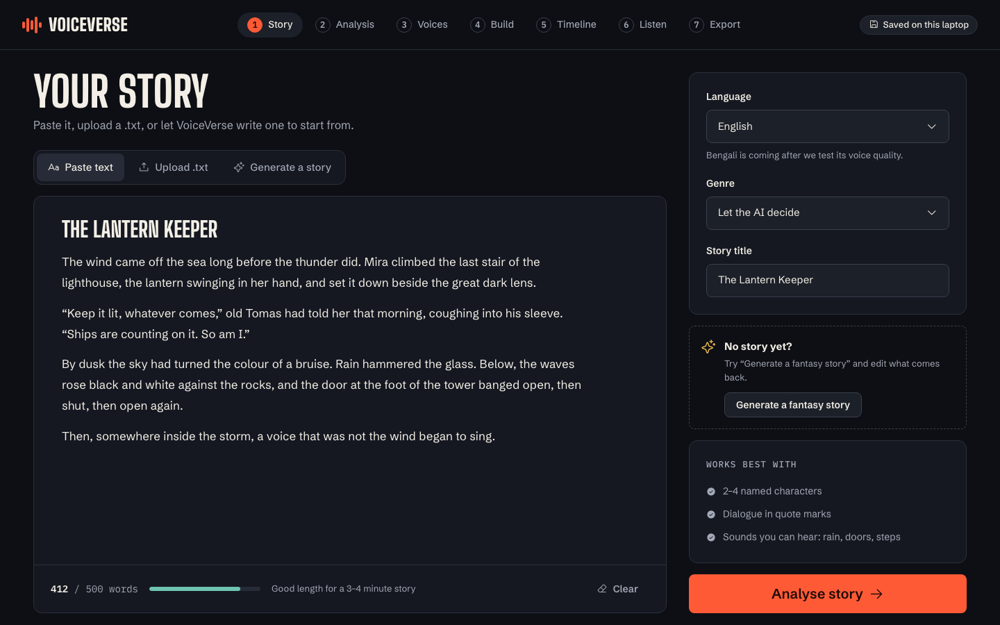
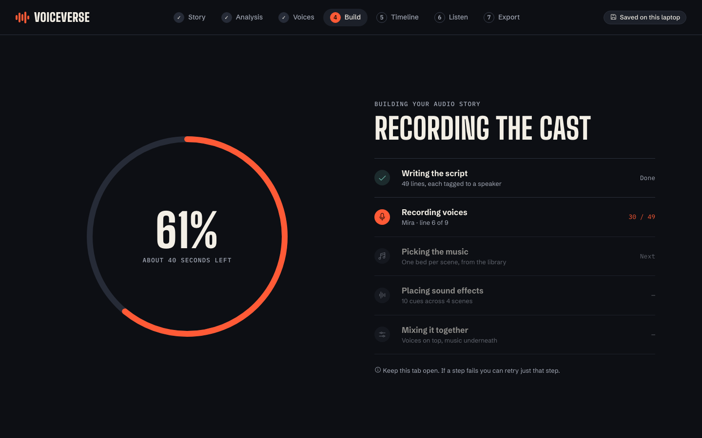
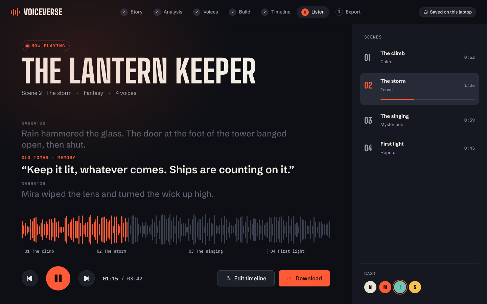
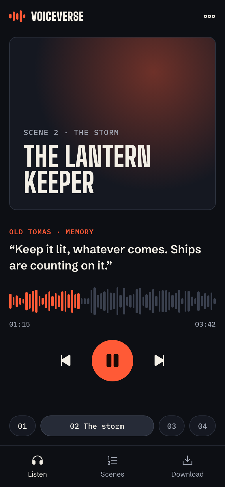

# VoiceVerse

**Turn any written story into a cinematic audio experience.**

VoiceVerse is an AI-powered audio-story studio. Paste or upload a story and it finds the scenes and characters, gives every character a voice, adds a narrator, scores each scene with mood music, places sound effects, and mixes it all into one audio story you can play, edit and download.

Built by **Team Byte Busters** for the **GeNarrative** hackathon.


## The problem

Writers, storytellers, podcasters and audiobook creators increasingly want their stories to be *heard*, not just read. But turning a written story into a good audio drama is slow, expensive and technical:

- **It needs a whole crew.** A narrator, a separate voice for every character, a composer or music library, a sound designer and an audio editor.
- **It needs skills most writers don't have.** Casting voices, timing dialogue, choosing music that fits each scene's mood, placing sound effects, and mixing it all so the voices stay clear.
- **It takes days, even for a few minutes of audio.** That puts audio storytelling out of reach for independent creators, students and small teams.
- **Plain text-to-speech isn't enough.** It reads a story in one flat voice, with no characters, no emotion, no music and no atmosphere.

## Our solution

**VoiceVerse turns any written story into a cinematic, multi-voice audio experience in minutes, with no audio skills needed.** The writer pastes a story and the AI does the work of the whole production crew:

| Production job | How VoiceVerse does it |
|---|---|
| **Script editor** | The AI (Gemini, ChatGPT, Claude, Grok… your choice) reads the story, splits it into scenes, and tags every line with its speaker and emotion |
| **Casting director** | The AI reads each character's lines and recommends the best-fitting voice from the catalogue, explaining why |
| **Voice actors** | ElevenLabs performs every line with emotion-aware settings (afraid, whispering, joyful…) |
| **Composer** | Each scene gets a music bed that fits its mood (calm, tense, mysterious, epic…) |
| **Sound designer** | Sound effects the story mentions (rain, thunder, doors, footsteps, magic…) are placed on the right line |
| **Audio editor** | Everything is mixed with the music ducking under voices, then exported as MP3 or WAV |

The writer stays in control: they can rename characters, change any scene's mood, swap voices, tune speed, tone and emotion, and move, change or remove sound effects on a multi-track timeline before downloading.

It also works with **no API keys at all**. A built-in offline story reader and the browser's own voices keep the full flow working for anyone, anywhere.

## Try it

**Live demo:** https://himanxhuwq.github.io/VoiceVerse/

Run it locally:

```bash
npm install
npm run dev
```

Then open http://localhost:5173. No keys are needed: without them VoiceVerse runs in **demo mode** with the built-in story reader and your browser's voices. For the full AI pipeline, click **Demo mode → AI keys** and paste an API key from **any supported AI provider** (it is recognised automatically) plus, optionally, an [ElevenLabs](https://elevenlabs.io) key for recorded voices. Keys stay in your browser and are sent only to the provider you chose and to ElevenLabs.

### Hindi and Bengali stories

VoiceVerse works with stories in **English, Hindi (हिन्दी) and Bengali (বাংলা)**. The language is detected automatically from the story's script (or chosen on the Story step), and everything follows it:

- **Story analysis** keeps every line in its own language and script. The built-in reader understands Hindi and Bengali dialogue tags (मीरा ने कहा, টুনি বলল) and family words for gender (काका, ঠাকুমা), and places sound effects from Hindi and Bengali words (बारिश, ঝড়).
- **Voices** come from the story's language: the browser's Hindi or Bengali voices in demo mode (for example Lekha and Piya on a Mac), with each character given a different pitch when they share a voice. With ElevenLabs, Hindi uses your chosen model and Bengali uses Eleven v3.
- **The AI** (any provider) is told the language, so analysis, story writing and voice casting stay in Hindi or Bengali.
- **Demo mode** includes a Hindi and a Bengali sample story: choose the language, open **Generate a story**, and click the button.

### Supported AI providers

| Provider | Key looks like | Model |
|---|---|---|
| Google Gemini | `AIza…` | newest stable Flash model |
| OpenAI (ChatGPT) | `sk-…` | newest GPT mini model |
| Anthropic Claude | `sk-ant-…` | newest Haiku model |
| xAI Grok | `xai-…` | newest fast Grok model |
| Groq | `gsk_…` | largest available open model |
| OpenRouter | `sk-or-…` | OpenRouter Auto (routes to a suitable model) |
| Mistral, DeepSeek | choose in settings | picked from your key's model list |
| Any OpenAI-compatible API | choose "Other", add the base URL | picked from the model list |

Models are never hard-coded: VoiceVerse asks the provider which models your key can use and picks one (or uses the model you type). If a model is retired, it switches to another automatically.

## What it does

| Step | What happens |
|---|---|
| **1. Story** | Paste text, upload a `.txt`, or have the AI write a story from an idea |
| **2. Analysis** | AI splits the story into scenes and speaker-tagged lines, finds characters (gender, age), mood per scene, genre, narration style and sound cues |
| **3. Voices** | The AI recommends the best voice for each character from their lines, with a reason; tune speed, tone and emotion, and preview any line |
| **4. Build** | Lines are recorded with ElevenLabs (2 at a time, the free-plan limit, with automatic retries), music is scored per mood, effects are placed, everything is mixed |
| **5. Timeline** | Multi-track editor: narration, dialogue, music and effects. Change a scene's music, swap, move, re-level or remove effects, reassign a line's speaker |
| **6. Listen** | Player with live lyrics, scene chapters, seekable waveform and "who's speaking" cast |
| **7. Export** | Download MP3 or WAV, or copy the full script |

## Architecture



### How the AI is used

- **One AI layer, any provider.** [`src/ai/providers.js`](src/ai/providers.js) describes each provider (how to recognise its keys, list its models, pick one, and send a prompt); [`src/ai/llm.js`](src/ai/llm.js) sends every request through it with a time limit, retries around options a model refuses (JSON mode, temperature, thinking), automatic model replacement, and plain-language errors.
- **Story analysis.** One structured-output call (JSON mode where the provider supports it) returns the whole breakdown: characters with gender and age, 2–5 scenes with a mood from a fixed list, every line of the story in order tagged with its speaker and an emotion, and sound-effect cues anchored to the line where they happen. The reply is validated and normalised (unknown speakers fall back to the narrator, cue indexes are clamped). All prompts live in [`src/ai/prompts.js`](src/ai/prompts.js).
- **Story generation.** Writes an original 300–380-word story shaped for audio drama: named characters, quoted dialogue with clear tags, and sounds a listener can hear.
- **AI voice casting.** After analysis, the AI acts as casting director: it reads each character's role and their own lines, compares them with the full voice catalogue (gender, age, accent, description), and picks the best-fitting voice for every character with a one-line reason, shown in the app as an "AI pick". Prompt: `castingPrompt` in [`src/ai/prompts.js`](src/ai/prompts.js).
- **Rule-based casting fallback.** Without an AI key, characters are matched to voices by gender, age (elder, young) and role (an ElevenLabs "narration" voice for the narrator); spirits get a slower, deeper whisper.
- **Emotional speech (ElevenLabs).** Each line's emotion maps to ElevenLabs `stability` and `style` settings (or rate, pitch and volume for browser voices), so an *afraid* line sounds different from a *calm* one.
- **Offline fallback.** If the AI is unavailable, a rule-based reader ([`src/ai/localReader.js`](src/ai/localReader.js)) attributes dialogue from speech verbs and pronouns, infers gender and age, splits scenes at time words, and scores mood, genre and sound cues from keywords, so the demo never breaks.

### Audio engine

All music and sound effects are **synthesised in the browser with the Web Audio API**: no audio files, no licensing. Each mood (calm, tense, mysterious, hopeful, sad, happy, epic) has its own chord progression and texture, and 17 effects (rain, thunder, wind, doors, footsteps, magic, bells…) are built from filtered noise and oscillators. The mixer renders the story with an `OfflineAudioContext`, ducks the music under every voice, and runs a compressor on the master bus. Export encodes WAV directly and MP3 with lamejs.

## Tech stack

| Layer | Technology |
|---|---|
| UI | React 18 + Vite |
| Animation | Motion (Framer Motion): page transitions, staggered reveals, shared-layout highlights, animated progress and waveforms |
| Story AI | Any of: Google Gemini, OpenAI, Anthropic Claude, xAI Grok, Groq, OpenRouter, Mistral, DeepSeek or an OpenAI-compatible API |
| Voices | ElevenLabs Text-to-Speech, or the browser's Web Speech API |
| Music & SFX | Web Audio API (procedural synthesis) |
| Mixing | OfflineAudioContext with ducking and compression |
| Export | WAV encoder + lamejs (MP3) |
| Hosting | GitHub Pages via GitHub Actions |

## Project structure

```
src/
├─ main.jsx                 entry: restores the session, mounts <App>
├─ App.jsx                  shell: top bar, animated view switching, keyboard shortcuts
├─ ai/
│  ├─ prompts.js            AI prompt templates
│  ├─ providers.js          supported AI providers: key detection, model lists, requests
│  ├─ llm.js                AI client: analysis, story writing, voice casting
│  ├─ localReader.js        offline rule-based story analyser
│  ├─ voices.js             voice lists, auto-casting, emotion → speech params
│  └─ tts.js                ElevenLabs + browser text-to-speech, previews
├─ audio/
│  ├─ nodes.js              Web Audio building blocks
│  ├─ music.js              procedural music per mood
│  ├─ sfx.js                17 procedural sound effects
│  ├─ mixer.js              timeline layout + offline mix rendering
│  ├─ playback.js           playback engine (mixed or live) + usePlayback hook
│  └─ exporter.js           WAV / MP3 encoding, script export
├─ state/
│  ├─ store.js              session state, persistence, API keys
│  ├─ navigation.js         step navigation, analyse / new story actions
│  ├─ build.js              the build pipeline + useBuild hook
│  └─ toast.js              notifications
├─ views/                   one component per step: Home, Story, Analysis,
│                           Voices, Build, Timeline, Player, Export
├─ components/              TopBar, SettingsModal, Toast, shared UI
├─ data/                    constants and sample stories
└─ styles/global.css        design tokens and layout
docs/                       progress report, spec, screenshots, first prototype
```

## Screens

| | | |
|---|---|---|
|  |  |  |
|  |  |  |
|  |  |  |

## Docs

- [Progress report (PDF)](docs/VoiceVerse%20progress%20report.pdf)
- [Product spec with pipeline diagram](docs/VoiceVerse%20spec%20with%20diagram.docx)
- [All UI screens](docs/ui-screens.html)
- [First single-file prototype](docs/prototype/voiceverse-single-file-prototype.html), kept for reference

## Roadmap

- PDF upload and Bengali support (once Bengali TTS quality is tested)
- A small backend to keep API keys server-side
- Shareable story links, with Supabase for saved stories
- Royalty-free recorded music and effect library alongside the synthesised one
