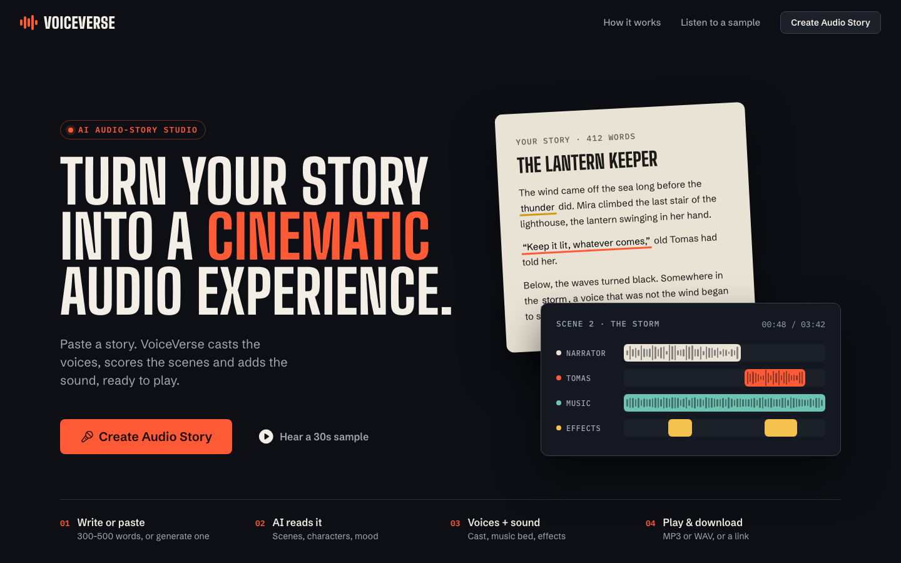
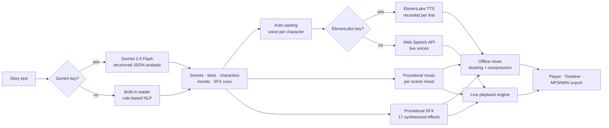
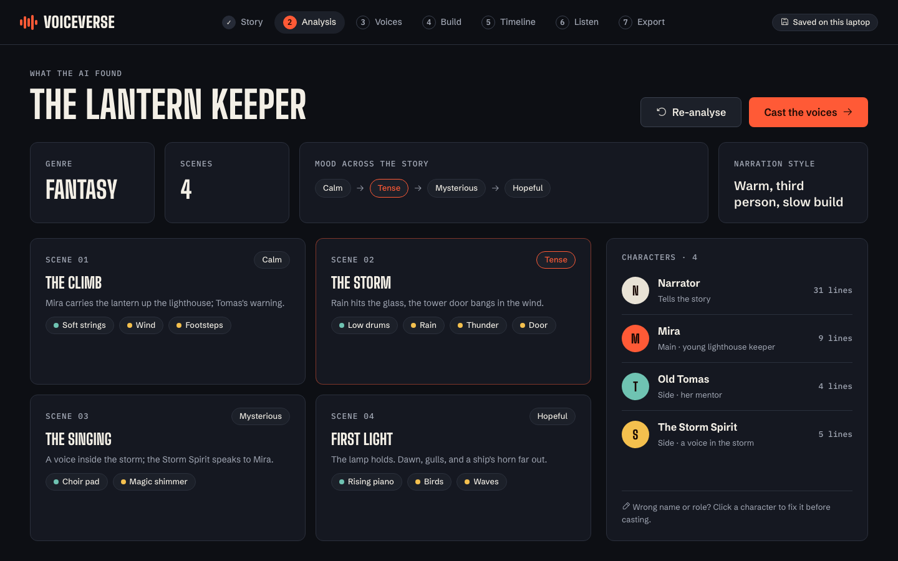
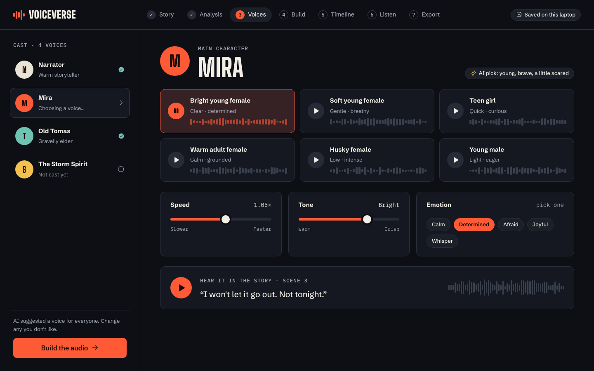
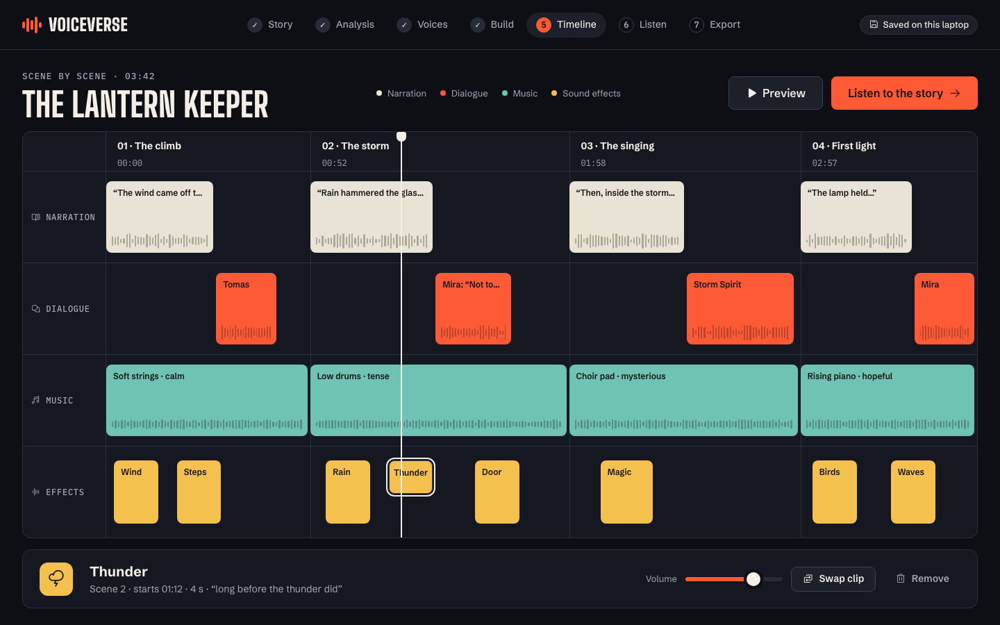
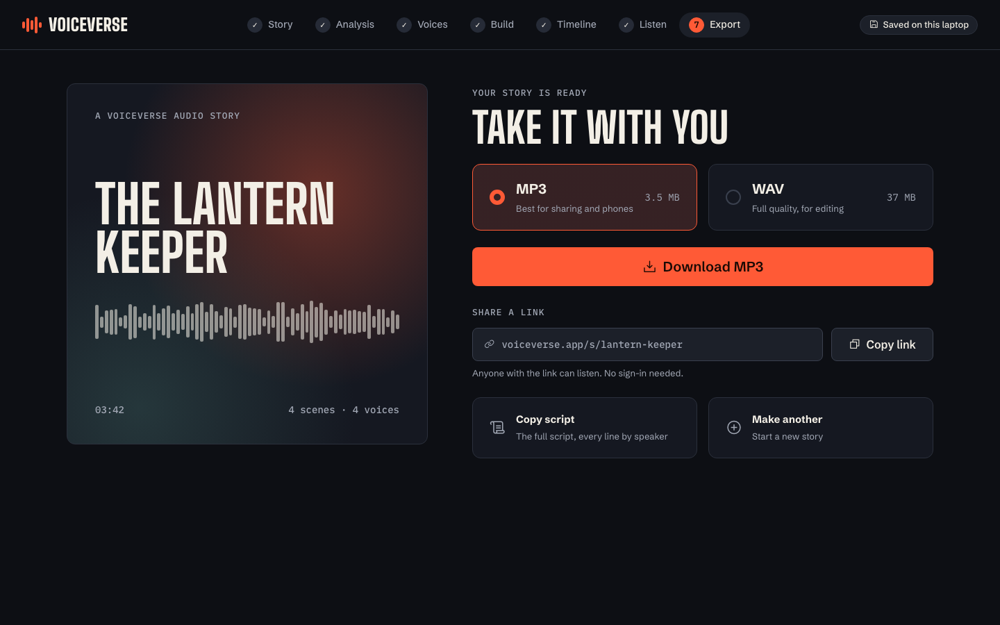

# VoiceVerse

**Turn any written story into a cinematic audio experience.**

VoiceVerse is an AI-powered audio-story studio. Paste or upload a story and it finds the scenes and characters, gives every character a voice, adds a narrator, scores each scene with mood music, places sound effects, and mixes it all into one audio story you can play, edit and download.

Built by **Team Byte Busters** for the **GeNarrative** hackathon.



## Try it

**Live demo:** https://himanxhuwq.github.io/VoiceVerse/

Run it locally:

```bash
npm install
npm run dev
```

Then open http://localhost:5173. No keys are needed: without them VoiceVerse runs in **demo mode** with the built-in story reader and your browser's voices. For the full AI pipeline, click **Demo mode → AI keys** and paste a [Gemini](https://aistudio.google.com/apikey) key and an [ElevenLabs](https://elevenlabs.io) key. Keys stay in your browser and are sent only to Google and ElevenLabs.

## What it does

| Step | What happens |
|---|---|
| **1. Story** | Paste text, upload a `.txt`, or have Gemini write a story from an idea |
| **2. Analysis** | AI splits the story into scenes and speaker-tagged lines, finds characters (gender, age), mood per scene, genre, narration style and sound cues |
| **3. Voices** | Each character is auto-cast to a fitting voice; tune speed, tone and emotion, and preview any line |
| **4. Build** | Lines are recorded with ElevenLabs (3 in parallel), music is scored per mood, effects are placed, everything is mixed |
| **5. Timeline** | Multi-track editor: narration, dialogue, music and effects. Change a scene's music, swap, move, re-level or remove effects, reassign a line's speaker |
| **6. Listen** | Player with live lyrics, scene chapters, seekable waveform and "who's speaking" cast |
| **7. Export** | Download MP3 or WAV, or copy the full script |

## Architecture



### How the AI is used

- **Story analysis (Gemini).** One structured-output call (`responseMimeType: application/json`) returns the whole breakdown: characters with gender and age, 2–5 scenes with a mood from a fixed list, every line of the story in order tagged with its speaker and an emotion, and sound-effect cues anchored to the line where they happen. The reply is validated and normalised (unknown speakers fall back to the narrator, cue indexes are clamped). All prompts live in [`src/ai/prompts.js`](src/ai/prompts.js).
- **Story generation (Gemini).** Writes an original 300–380-word story shaped for audio drama: named characters, quoted dialogue with clear tags, and sounds a listener can hear.
- **Voice casting.** Characters are matched to voices by gender, age (elder, young) and role (an ElevenLabs "narration" voice for the narrator); spirits get a slower, deeper whisper.
- **Emotional speech (ElevenLabs).** Each line's emotion maps to ElevenLabs `stability` and `style` settings (or rate, pitch and volume for browser voices), so an *afraid* line sounds different from a *calm* one.
- **Offline fallback.** If Gemini is unavailable, a rule-based reader ([`src/ai/localReader.js`](src/ai/localReader.js)) attributes dialogue from speech verbs and pronouns, infers gender and age, splits scenes at time words, and scores mood, genre and sound cues from keywords, so the demo never breaks.

### Audio engine

All music and sound effects are **synthesised in the browser with the Web Audio API**: no audio files, no licensing. Each mood (calm, tense, mysterious, hopeful, sad, happy, epic) has its own chord progression and texture, and 17 effects (rain, thunder, wind, doors, footsteps, magic, bells…) are built from filtered noise and oscillators. The mixer renders the story with an `OfflineAudioContext`, ducks the music under every voice, and runs a compressor on the master bus. Export encodes WAV directly and MP3 with lamejs.

## Tech stack

| Layer | Technology |
|---|---|
| UI | React 18 + Vite |
| Animation | Motion (Framer Motion): page transitions, staggered reveals, shared-layout highlights, animated progress and waveforms |
| Story AI | Google Gemini 2.5 Flash (structured JSON output) |
| Voices | ElevenLabs Text-to-Speech, or the browser's Web Speech API |
| Music & SFX | Web Audio API (procedural synthesis) |
| Mixing | OfflineAudioContext with ducking and compression |
| Export | WAV encoder + lamejs (MP3) |
| Hosting | GitHub Pages via GitHub Actions |

## Project structure

```
src/
├─ main.jsx                 entry: restores the session, mounts <App>
├─ App.jsx                  shell: top bar, animated view switching, keyboard shortcuts
├─ ai/
│  ├─ prompts.js            Gemini prompt templates
│  ├─ gemini.js             Gemini client: analysis + story generation
│  ├─ localReader.js        offline rule-based story analyser
│  ├─ voices.js             voice lists, auto-casting, emotion → speech params
│  └─ tts.js                ElevenLabs + browser text-to-speech, previews
├─ audio/
│  ├─ nodes.js              Web Audio building blocks
│  ├─ music.js              procedural music per mood
│  ├─ sfx.js                17 procedural sound effects
│  ├─ mixer.js              timeline layout + offline mix rendering
│  ├─ playback.js           playback engine (mixed or live) + usePlayback hook
│  └─ exporter.js           WAV / MP3 encoding, script export
├─ state/
│  ├─ store.js              session state, persistence, API keys
│  ├─ navigation.js         step navigation, analyse / new story actions
│  ├─ build.js              the build pipeline + useBuild hook
│  └─ toast.js              notifications
├─ views/                   one component per step: Home, Story, Analysis,
│                           Voices, Build, Timeline, Player, Export
├─ components/              TopBar, SettingsModal, Toast, shared UI
├─ data/                    constants and sample stories
└─ styles/global.css        design tokens and layout
docs/                       progress report, spec, screenshots, first prototype
```

## Screens

| | | |
|---|---|---|
|  |  |  |
|  |  |  |
|  |  |  |

## Docs

- [Progress report (PDF)](docs/VoiceVerse%20progress%20report.pdf)
- [Product spec with pipeline diagram](docs/VoiceVerse%20spec%20with%20diagram.docx)
- [All UI screens](docs/ui-screens.html)
- [First single-file prototype](docs/prototype/voiceverse-single-file-prototype.html), kept for reference

## Roadmap

- PDF upload and Bengali support (once Bengali TTS quality is tested)
- A small backend to keep API keys server-side
- Shareable story links, with Supabase for saved stories
- Royalty-free recorded music and effect library alongside the synthesised one
